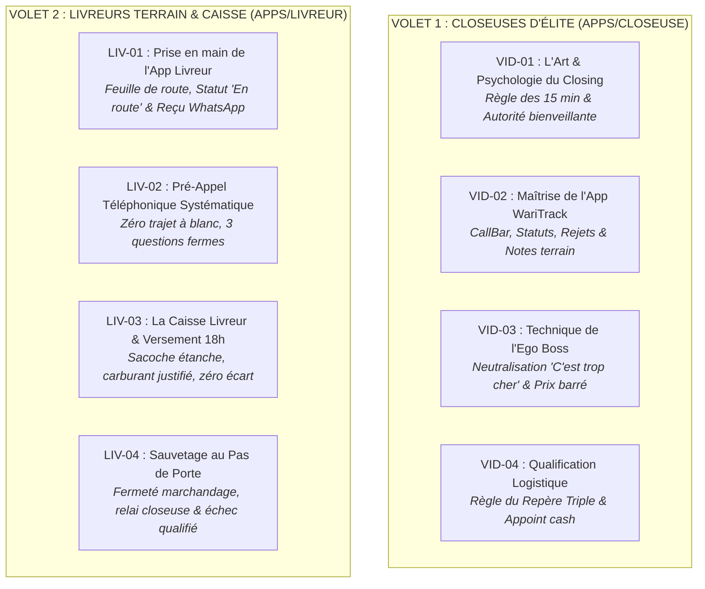

# 🎬 WariTrack COD Academy — Playbooks & Vidéos de Formation (Google Flow & Terrain)

Ce dossier regroupe le matériel de formation complet pour les équipes de vente téléphonique (**Closeuses**) et de logistique terrain (**Livreurs**), spécialement calibré pour le e-commerce Cash On Delivery (COD) en Afrique de l'Ouest (Togo, Sénégal, Côte d'Ivoire, Bénin).

---

## 📦 FICHIERS & LIVRABLES DISPONIBLES

### 1. Volet 1 : Formation Closeuses D'Élite (4 Modules)
- **Fichier PDF Officiel** : [`Guide_Formation_Closeuses_WariTrack.pdf`](file:///c:/Users/REMCOM2/Desktop/ecom-cd-socle-technique/docs/formations/Guide_Formation_Closeuses_WariTrack.pdf) *(Document haute qualité prêt pour impression ou diffusion)*
- **Source HTML Imprimable** : [`guide_closeuses.html`](file:///c:/Users/REMCOM2/Desktop/ecom-cd-socle-technique/docs/formations/guide_closeuses.html) *(CSS print responsive, typographie de prestige)*
- **Playbook Markdown & Prompts Google Flow** : [`VOLET_1_FORMATION_CLOSEUSES.md`](file:///c:/Users/REMCOM2/Desktop/ecom-cd-socle-technique/docs/formations/VOLET_1_FORMATION_CLOSEUSES.md) *(Scripts mot-à-mot, chrono et prompts 9:16)*

### 2. Volet 2 : Formation Livreurs Terrain & Caisse (4 Modules)
- **Fichier PDF Officiel** : [`Guide_Formation_Livreurs_WariTrack.pdf`](file:///c:/Users/REMCOM2/Desktop/ecom-cd-socle-technique/docs/formations/Guide_Formation_Livreurs_WariTrack.pdf) *(Document haute qualité prêt pour impression ou diffusion)*
- **Source HTML Imprimable** : [`guide_livreurs.html`](file:///c:/Users/REMCOM2/Desktop/ecom-cd-socle-technique/docs/formations/guide_livreurs.html) *(CSS print responsive, règles d'airain)*
- **Playbook Markdown & Prompts Google Flow** : [`VOLET_2_FORMATION_LIVREURS.md`](file:///c:/Users/REMCOM2/Desktop/ecom-cd-socle-technique/docs/formations/VOLET_2_FORMATION_LIVREURS.md) *(Scripts d'appel, protocoles caisse et sauvetage au pas de porte)*

---

## 🎯 SYNTHÈSE DES 8 CAPSULES VIDÉO (FORMAT VERTICAL 9:16)

---

## 💎 LA FORMULE ROYALE : "C'EST TROP CHER" (MODULE 3 CLOSEUSE)

> **Script mot-à-mot à faire pratiquer par toutes les closeuses :**
> *"Oui, je comprends tout à fait Monsieur [Nom]. Ce produit-là n'est effectivement pas pour tout le monde.*  
> *Sa qualité premium et son utilité en font un produit de très forte valeur.*  
> *En réalité, nous sommes en promotion exclusive aujourd'hui : le vrai prix officiel est de [35 000 XOF], mais la direction nous autorise exceptionnellement à vous l'accorder aujourd'hui à [22 000 XOF]."*  
> *(Puis silence d'or : le premier qui parle a perdu).*

---

## 🚀 GUIDE D'IMPORTATION DANS GOOGLE FLOW / RUNWAY

1. Ouvrir Google Flow ou votre studio de montage (Format sélectionné : **9:16 Vertical**).
2. Pour chaque scène du script, copier-coller le bloc **Google Flow / Motion Prompt (9:16)** pour générer le visuel d'arrière-plan ou l'animation 3D.
3. Importer ou faire dicter la **Voix-off** mot-à-mot (voix française posée, chaleureuse et persuasive).
4. Ajouter les **Textes incrustés à l'écran (Lower Thirds)** aux chronométrages indiqués.
